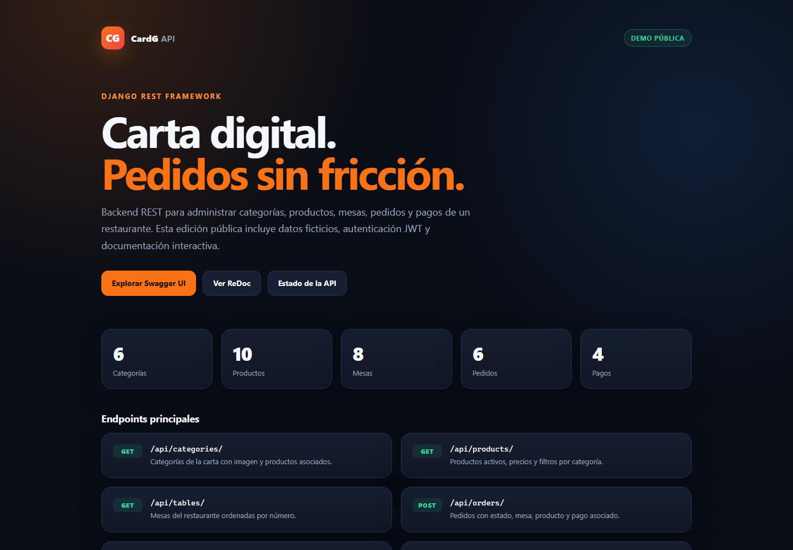
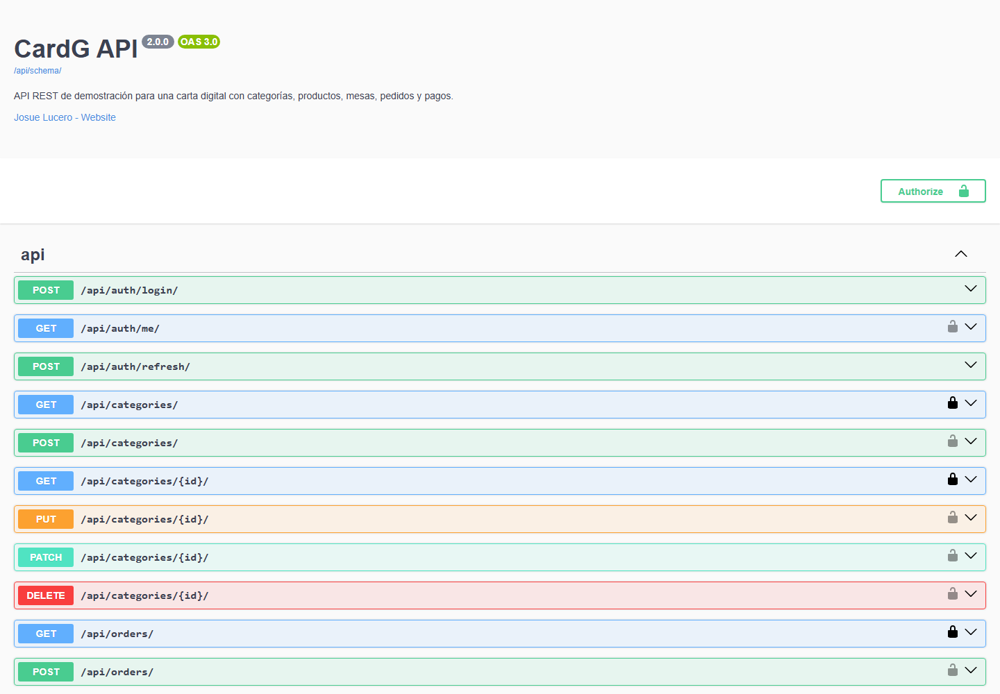

# CardG API

API REST de demostración para una carta digital de restaurante: categorías, productos, mesas, pedidos y pagos. Proyecto de portafolio construido con Django REST Framework, autenticación JWT y documentación OpenAPI.

> Esta es una edición pública con datos ficticios. La base de datos original, los archivos subidos por usuarios y los artefactos de desarrollo fueron eliminados del repositorio.



## Características

- CRUD de categorías, productos, mesas, pedidos y pagos.
- Lectura pública y escritura autenticada.
- Autenticación con JWT (access y refresh tokens).
- Panel de administración de Django.
- Filtros por categoría, estado, mesa, pago y número de mesa.
- Documentación interactiva con Swagger UI y ReDoc.
- Comando `seed_demo` para crear una carta, mesas, pedidos, pagos y usuarios ficticios.
- Pruebas de API, permisos, autenticación, filtros y datos de demostración.
- Configuración por variables de entorno para despliegue.

## Capturas

| Panel principal | Swagger UI |
| --- | --- |
|  |  |

## Stack

| Componente | Versión |
| --- | --- |
| Python | 3.12+ |
| Django | 5.2 |
| Django REST Framework | 3.18 |
| Simple JWT | 5.5 |
| drf-spectacular | 0.30 |
| SQLite | Desarrollo y demostración |
| WhiteNoise | Archivos estáticos |

## Arquitectura

| App | Responsabilidad |
| --- | --- |
| `users` | Usuario personalizado, autenticación y administración de cuentas. |
| `categories` | Categorías de la carta con imagen. |
| `products` | Productos, precios, disponibilidad y categoría. |
| `tables` | Mesas del restaurante. |
| `orders` | Pedidos por mesa, producto y estado. |
| `payments` | Pagos en efectivo o tarjeta, pendientes o completados. |
| `core` | Comando de datos ficticios y utilidades de pruebas. |

## Endpoints principales

| Método | Ruta | Acceso | Descripción |
| --- | --- | --- | --- |
| `GET` | `/` | Público | Panel de presentación con el resumen de la demo. |
| `GET` | `/api/health/` | Público | Estado del servicio y de la base de datos. |
| `GET` | `/api/schema/` | Público | Esquema OpenAPI 3. |
| `GET` | `/docs/` | Público | Swagger UI interactivo. |
| `GET` | `/redoc/` | Público | Documentación ReDoc. |
| `POST` | `/api/auth/login/` | Público | Inicio de sesión; recibe `email` y `password`. |
| `POST` | `/api/auth/refresh/` | Público | Renueva el access token con un refresh token. |
| `GET` | `/api/auth/me/` | Autenticado | Perfil del usuario actual. |
| `GET/POST` | `/api/users/` | Solo admin | Listado y creación de usuarios. |
| `GET/POST` | `/api/categories/` | Lectura pública / escritura autenticada | Categorías. |
| `GET/POST` | `/api/products/` | Lectura pública / escritura autenticada | Productos. |
| `GET/POST` | `/api/tables/` | Lectura pública / escritura autenticada | Mesas. |
| `GET/POST` | `/api/orders/` | Lectura pública / escritura autenticada | Pedidos. |
| `GET/POST` | `/api/payments/` | Lectura pública / escritura autenticada | Pagos. |

Los detalles de cada operación, parámetros y respuestas están disponibles en `/docs/`.

## Inicio rápido

### Requisitos

- Python 3.12 o superior.
- Git.

### Windows (PowerShell)

```powershell
git clone https://github.com/JosueLuceroG/cardg.git
cd cardg
py -3.12 -m venv .venv
.venv\Scripts\Activate.ps1
python -m pip install -r requirements.txt
python manage.py migrate
python manage.py seed_demo --reset
python manage.py runserver
```

### Linux / macOS

```bash
git clone https://github.com/JosueLuceroG/cardg.git
cd cardg
python3 -m venv .venv
source .venv/bin/activate
python -m pip install -r requirements.txt
python manage.py migrate
python manage.py seed_demo --reset
python manage.py runserver
```

Abre `http://127.0.0.1:8000/`.

> `seed_demo --reset` elimina los datos de las apps de la carta antes de sembrar la demo. Úsalo solo en una base de demostración.

## Datos de demostración

El comando crea:

- 6 categorías.
- 10 productos (9 activos y 1 inactivo).
- 8 mesas.
- 6 pedidos.
- 4 pagos.
- 3 usuarios ficticios.

| Rol | Correo | Contraseña |
| --- | --- | --- |
| Administrador | `admin@cardg.demo` | `Admin12345!` |
| Mesero | `mesero@cardg.demo` | `Mesero12345!` |
| Cliente | `cliente@cardg.demo` | `Cliente12345!` |

Las cuentas son únicamente para la demostración local. No reutilices estas credenciales en un despliegue real.

## Ejemplos de uso

Iniciar sesión:

```bash
curl -X POST http://127.0.0.1:8000/api/auth/login/ \
  -H "Content-Type: application/json" \
  -d '{"email":"admin@cardg.demo","password":"Admin12345!"}'
```

Renovar el access token:

```bash
curl -X POST http://127.0.0.1:8000/api/auth/refresh/ \
  -H "Content-Type: application/json" \
  -d '{"refresh":"TU_REFRESH_TOKEN"}'
```

Consultar productos activos:

```bash
curl "http://127.0.0.1:8000/api/products/?active=true"
```

Crear un pedido autenticado:

```bash
curl -X POST http://127.0.0.1:8000/api/orders/ \
  -H "Content-Type: application/json" \
  -H "Authorization: Bearer TU_ACCESS_TOKEN" \
  -d '{"status":"PENDING","table":1,"product":1,"close":false}'
```

## Pruebas

```bash
python manage.py test
```

La suite actual contiene 60 pruebas. Consulta [TESTING.md](TESTING.md) para los comandos de verificación y los resultados de la edición pública.

## Variables de entorno

Copia `.env.example` como referencia. Django lee las variables directamente del sistema; no se incluye un cargador de `.env`.

| Variable | Uso |
| --- | --- |
| `DJANGO_SECRET_KEY` | Clave secreta de Django. Obligatoria en producción. |
| `DJANGO_DEBUG` | `1` para desarrollo, `0` para producción. |
| `DJANGO_ALLOWED_HOSTS` | Hosts separados por coma. |
| `CORS_ALLOWED_ORIGINS` | Orígenes permitidos en producción. |
| `CSRF_TRUSTED_ORIGINS` | Orígenes confiables para CSRF. |
| `DJANGO_TIME_ZONE` | Zona horaria; por defecto `UTC`. |

Para producción, como mínimo:

1. Define una `DJANGO_SECRET_KEY` larga y aleatoria.
2. Configura `DJANGO_DEBUG=0`.
3. Define `DJANGO_ALLOWED_HOSTS`, `CORS_ALLOWED_ORIGINS` y `CSRF_TRUSTED_ORIGINS`.
4. Usa una base de datos administrada en lugar de SQLite.
5. Sirve el sitio detrás de HTTPS.

## Estructura del proyecto

```text
cardg/
├── categories/          # Categorías de la carta
├── core/                # Comando seed_demo y utilidades de prueba
├── demo_assets/         # Imágenes ficticias para la demo
├── icard/               # Configuración, URLs y panel principal
├── orders/              # Pedidos
├── payments/            # Pagos
├── products/            # Productos
├── screenshots/         # Capturas para el README
├── tables/              # Mesas
├── templates/           # Plantilla del panel principal
├── users/               # Usuario personalizado y autenticación
├── manage.py
├── Procfile
├── requirements.txt
└── requirements-dev.txt
```

## Alcance y seguridad

- No se publican bases de datos reales, contraseñas, archivos de usuarios ni historial de Git con datos sensibles.
- Las imágenes de `demo_assets/` se usan solo para la demostración y no contienen metadatos EXIF.
- El proyecto no incluye licencia de código abierto. Todos los derechos reservados; se publica como muestra de portafolio.
- Para reportar un problema de seguridad, abre un issue sin incluir datos sensibles.

## Contacto

- GitHub: [@JosueLuceroG](https://github.com/JosueLuceroG)
- Documentación en vivo: ejecuta el proyecto y visita `/docs/`.
